<!--
F6.3 final report (FR-27). Draft written 2026-10-20 by Claude Code at member A's request, from the generated
files only. Both members must review and edit it before submission.

Rules for editing:
- Numbers are copied from generated files only (RULES §9): reports/tables/report/*.md (rounded report tables,
  each with a .tex twin) and reports/tables/*.csv. Each number in the text names its table. After any re-run,
  regenerate with `docker compose exec spark python -m musin.report --config config/pipeline.yaml` and re-check.
- reports/README.md lists every figure and table and the command that makes it.
- Format: Markdown (pandoc can turn it into PDF or DOCX). For LaTeX, \input the .tex tables
  (booktabs; XeLaTeX or LuaLaTeX for CJK names, ρ and ×).

Before submission (team):
- [ ] Fill in the names and confirm the deadline (M6, Nov 9).
- [ ] Both members review the F4.6 spot-check verdicts before the top lists in §6 are quoted as they stand.
- [ ] Check the course's policy on declaring AI assistance. Claude Code built most stages and chose the
      validation list at member B's request (D-037); the build log says so. §10 has a draft statement.
- [ ] Optional: draw the architecture diagram as a figure (§3 has it as text).
-->

# Bridging Genres: A Big-Data Analysis of the MusicBrainz Collaboration Network

**Team:** Member A — `<name>` (data engineering) · Member B — `<name>` (graph analytics)
**Course:** Big Data Analytics, semester project, 2026
**Data:** MusicBrainz full export `20261007-002147` · final graph `full`, edges fingerprint `-2227712706449027820962`

## Abstract

Music genres are usually studied one artist at a time, but music is made together. We turned the complete MusicBrainz database export (40.5 million recordings, 3.0 million artists; `data_funnel`) into a typed, weighted artist collaboration graph with PySpark. The graph covers billed credits, featuring credits and producer and performer credits. We loaded it into Neo4j and analysed it with the Graph Data Science library. The final graph has 1,135,461 artists and 3,078,519 typed edges (`data_funnel`).

Collaboration is strongly genre-clustered: 75.8 % of labelled collaboration weight stays within one genre (`rq1_bridges_summary`). The artists who bridge genres are mostly producers, session musicians and world and roots musicians. Louvain communities match genres only partly (AMI 0.186; `rq2_communities_runs`); the large communities are scenes, not genres. The cross-genre share of collaboration rose from 16.0 % in the 1960s to 28.4 % in the 2020s, while featuring credits went from 3.4 % to 19.0 % of billed collaborations, peaking at 23.1 % in the 2010s (`rq3_trends`). Weighted degree, PageRank and betweenness agree moderately over all artists but barely at the top (`rq4_agreement`). Benchmarks support the architecture. Spark runs the full recording chain, from credit parsing to the graph build, in 385 s on 8 cores (`bench_scaling`). Neo4j GDS computes PageRank about 123 times faster than Spark GraphFrames, with the same result (`bench_pagerank`).

## 1. Introduction

A collaboration graph shows who connects musical scenes that would otherwise be separate: the producer who works with rappers and folk singers, or the session player on country and jazz records. MusicBrainz is the largest open music database and records who is billed on each recording, who is featured, and who produced or played on it. It is also relational, large and noisy:
- genres are user-voted tags;
- credit coverage is uneven;
- placeholder "artists" such as *Various Artists* connect to everything.

Turning it into a graph one can trust is half the work of this project.

We ask four research questions (PRD §5):

- **RQ1 — Bridges:** which artists connect genres?
- **RQ2 — Communities:** do collaboration communities match genres?
- **RQ3 — Trends:** has cross-genre collaboration changed over the decades?
- **RQ4 — Centrality:** who is most central, and do different centrality measures agree?

The goals were set before any analysis:
- process the complete export with Spark, not a sample or the web API;
- document every filtering choice;
- define every metric formally and validate the results against a pre-registered list;
- justify the architecture with measured benchmarks;
- be reproducible from a clean clone.

Section 2 describes the data, §3 the architecture and §4 the processing. §5 defines the methods and §6 gives the results. §7 reports the benchmarks, §8 and §9 discuss the results and their limitations, and §10 covers reproducibility.

### 1.1 Related work

Collaboration networks have been a standard object of network science since Newman's study of scientific co-authorship [Newman 2001]. For music, Gleiser and Danon built a network of jazz musicians who played in the same bands. They found communities that reflect recording locations and racial segregation [Gleiser & Danon 2003]. Park et al. analysed a social network of contemporary popular musicians built from an online music guide [Park et al. 2007]. Bryan and Wang ranked artist and genre influence in a network of sampling relations from WhoSampled [Bryan & Wang 2011]; they found strong influence of funk, soul and disco on hip hop, R&B and electronic music. These studies use curated or crawled data at the scale of thousands to tens of thousands of nodes.

Our work differs in three ways:
- **Scale and source:** it processes the full open MusicBrainz export [Swartz 2002], about a million artists, with a big-data pipeline instead of a crawl.
- **Credits:** it combines billed credits with producer and performer credits in one typed graph.
- **Genres:** it measures genre bridging directly, with a Gini–Simpson diversity index [Simpson 1949] combined with betweenness centrality [Freeman 1977; Brandes 2001].

Communities come from Louvain modularity optimisation [Blondel et al. 2008] and are compared with genres using normalised and adjusted mutual information [Vinh et al. 2010]. Centrality also uses PageRank [Page et al. 1999].

## 2. Data

**Source.** We use the MusicBrainz full export of snapshot `20261007-002147`, schema sequence 31: the core dump (CC0) and the derived dump with user tags (CC BY-NC-SA 3.0). Checksums were verified on download (F1.2). The web API, limited to about one request per second, is not used. The dump files are headerless PostgreSQL `COPY` text. Column names and order come from `CreateTables.sql` at the matching `musicbrainz-server` commit (D-014). We use 22 tables (PRD §6.2):
- artists and artist types;
- artist credits and their join phrases;
- recordings, tracks, media, releases and release dates;
- recording-level relationships (producer, performer, instrument, vocal);
- band membership;
- the official genre list;
- the artist and release-group tags.

**Scale.** The dump holds 40,475,049 recordings, 58,292,678 tracks, 3,005,875 artists, 7,268,126 artist-credit names and 19,009,084 artist–recording relationships (`data_funnel`, steps 1–5).

**Profile** (F1.4; `profile_summary.csv`):
- **Credits:** 2,020,979 artists are credited on at least one recording; 34,883,833 recordings (86 %) have exactly one credited artist.
- **Release years:** 92.6 % of recordings get a first release year.
- **Contribution credits are sparse:** only 4.4 % of recordings have a producer credit and 8.1 % a performer credit.

The credit-size distribution motivated the cap on large credits (Figure 1). The decade distribution motivated the RQ3 range (Figure 2).

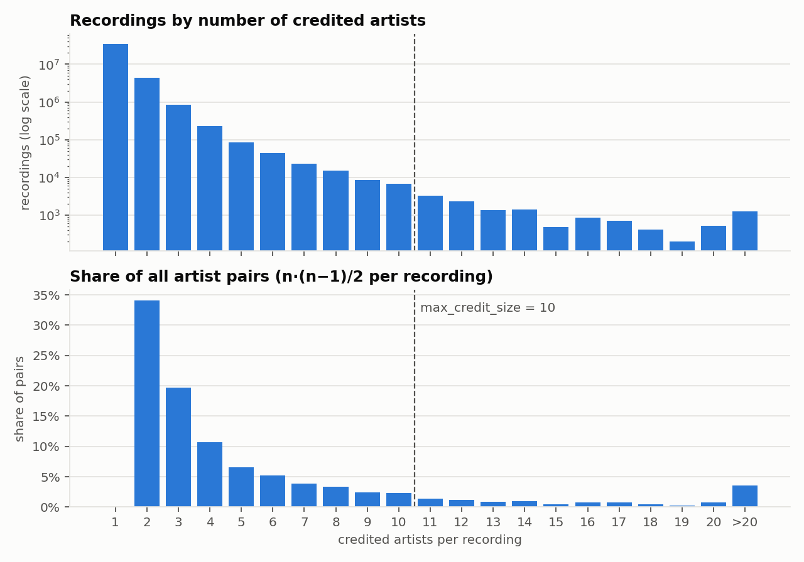

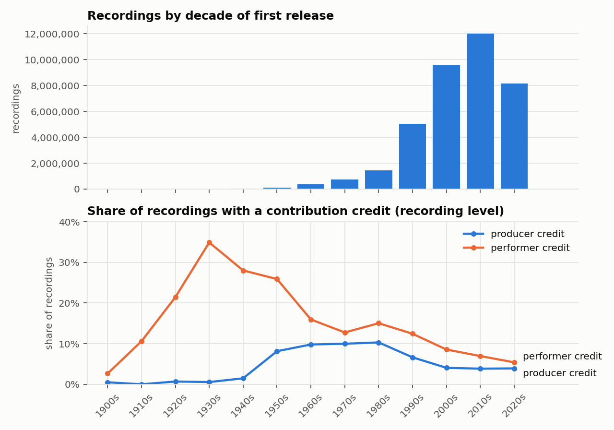

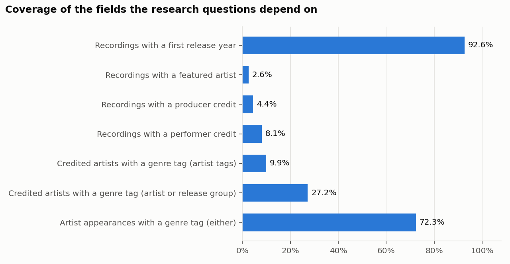

**Genres.** MusicBrainz genres are user-voted tags. We kept only tags that are official MusicBrainz genres or their aliases, and mapped 1,257 of the 2,212 official genres to 15 parent genres (F2.5, D-024). The mapped genres carry 97.5 % of all genre votes (`genre_coverage.csv`). Each artist gets a genre profile, from its own tags or else from its release groups' tags, and a single **primary genre**: the parent genre with the highest vote share, ties broken alphabetically. 26.6 % of credited artists get a primary genre. They account for 69.9 % of artist appearances on recordings, because popular artists are tagged far more often (`genre_coverage.csv`). Table 1 lists the parent genres.

Table 1 — [`data_genres`](../reports/tables/report/data_genres.md): the 15 parent genres, their mapped official genres, votes and artists.

**Known issues** and how we handle them (PRD §6.3):
- **Placeholder artists** are removed.
- **Large credits** would create N² edges.
- **Groups and their own members** look like collaborators.
- **Classical music** creates giant hubs: orchestras, conductors and composers.
- **Character artists** (singing-synthesiser voicebanks, fictional characters) are credited like performers.
- **Contribution credits** are rich mainly for popular music.
- **Recordings have no date of their own.**

§4 describes the handling of each.

## 3. Architecture

```
MusicBrainz full export (pinned snapshot): mbdump + mbdump-derived
        │  download, verify checksums                                   (P1)
        ▼
PySpark 3.5, local mode, Docker on WSL2
  raw/     headerless TSV → typed Parquet, one dataset per table        (P1)
  clean/   artists, credits, contributions, recording years, genres     (P2)
  graph/   nodes_artist, artist_genre, edges, edges_by_decade           (P3)
        │  CSV in neo4j-admin import format, bulk import
        ▼
Neo4j 5 Community + Graph Data Science → centrality, communities,
bridges, paths; results written back and streamed to reports/           (P4)
        ▼
reports/ (tables, figures) → report, slides, demo                       (P6)
Benchmarks (P5): Spark scaling · PageRank in GDS vs GraphFrames vs cuGraph
```

The pipeline has layers (`raw/` → `clean/` → `graph/` → `import/` → `reports/`):
- each stage reads only the layer before it and rewrites its whole output, so every stage can be re-run on its own;
- Parquet is the storage format between the Spark stages;
- every stage is one command with a single configuration file.

**Why these engines.**
- **Spark** handles the relational part of the work: joins of tens of millions of rows, credit parsing and edge aggregation.
- **Neo4j with GDS** runs the graph algorithms. It also serves Cypher path queries, stores the results on the nodes and runs the live demo.
- **Hadoop, HDFS and Hive are deliberately not used** (D-004). One machine holds the data, and a cluster would add operational cost without answering any research question.

§7 measures both halves of this split.

**Environment.** Everything runs in Docker Compose on WSL2. The reference machine is a laptop with 24 GB RAM (17.6 GiB visible in WSL) and an RTX 4060 Laptop GPU (`bench_environment`).
- **Memory budget:** WSL 18 GB; Spark driver 12 GB; Neo4j heap 8 GB plus 5 GB page cache.
- **One heavy engine at a time:** Spark and Neo4j heavy jobs never run together.
- **Configuration split:** settings that change results live in `config/pipeline.yaml`; per-machine settings and secrets live in `.env`. A missing key fails loudly; there are no hidden defaults in code.
- **Sample mode** (`--sample 0.05`) keeps recordings by a hash of their id. That makes samples deterministic, and both members could develop on small machines (FR-12).

## 4. Data processing and graph construction

**Cleaning** (P2):
- **Special-purpose artists** are removed everywhere downstream (F2.1).
- **Credits** are parsed into main and featured artists from the join phrases ("feat.", "with", …) (F2.2).
- **Producer and performer relationships** go through a link-type allowlist (F2.3).
- **First release year:** each recording's earliest year across all its releases (F2.4).

**Edge model** (PRD §8.2; F3.1). There are four edge types:
- **CO_CREDITED:** two main, or two featured, artists billed on the same recording;
- **FEATURED:** main → featured artist;
- **PRODUCED_FOR:** producer → billed main artist;
- **PERFORMED_FOR:** performer → billed main artist.

Each edge's weight is the number of distinct recordings the pair shares. Each recording counts once per artist pair, even if the pair is linked by several credits on it (D-028). A second table, `edges_by_decade`, splits each edge's weight by the decade of each recording's first release (for RQ3).

**Filters.** Each one is configured, counted and justified:
- **Credit-size cap:** recordings with more than `max_credit_size` (10) credited artists produce no pairwise edges. 12,769 such recordings would have produced 1,464,888 pair instances (`data_funnel`, steps 8–9).
- **Groups and their own members:** edges between a group and its members ("member of band") are removed (FR-11).
- **Character artists** are left out (18,052 artists; D-021). The sensitivity variant `characters` keeps them.
- **Classical artists** are left out (32,202 artists; D-039). The variant `classical` keeps them.
- **`min_recordings`** stays at 1 (D-040).

Figure 4 and Table 2 show what each rule did to the edge instances:
- only 26.2 % of PERFORMED_FOR instances survive. The rest are classical (3.5 M), self-loops of performers credited on their own recordings (3.0 M), group ↔ own member pairs (1.7 M) or pairs already linked on the same recording (1.5 M);
- classical artists account for the largest share of the removed CO_CREDITED instances.

The kept instances aggregate to 3,078,519 edges between 1,135,461 artists (`data_funnel`, steps 13–15).

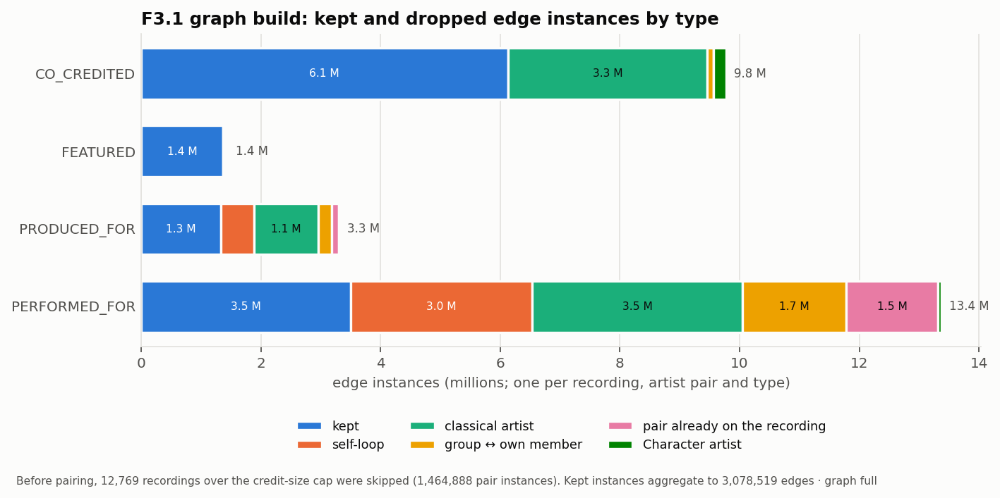

Table 2 — [`graph_instances`](../reports/tables/report/graph_instances.md): edge instances by type and drop reason. Table 3 — [`data_funnel`](../reports/tables/report/data_funnel.md): from dump rows to the loaded graph, each value copied from a named table metric.

**Quality checks** (F3.3) run after every build. There are 49 checks:
- no self-loops;
- no duplicate (source, target, type);
- every endpoint exists;
- the `edges_by_decade` totals match the edge weights;
- row counts within a tolerance of the previous run.

43 passed and 6 run-to-run count changes were reviewed and accepted after the scope-gate rebuild (`data_quality`).

**Load.** The graph is exported in `neo4j-admin` import format and bulk-loaded (F3.4). GDS then builds two in-memory projections (F3.5, D-017):
- **COLLAB:** all four types merged, undirected, one relationship per artist pair, weight summed over types. It has 2,863,538 artist pairs and 12,329,531 shared recordings (`data_funnel`, steps 16–17).
- **credit-only:** CO_CREDITED and FEATURED only, as a sensitivity check.

## 5. Methods

**Genre attribution.** An artist counts only through its primary genre. An edge is *labelled* when both endpoints have one. Unlabelled edges are left out of every genre metric, but stay in the graph for centrality and communities. In the final graph, 250,126 of the 1,135,461 artists (22.0 %) have a primary genre (`rq2_communities_runs` notes).

**RQ1 — bridges.**
- **Genre diversity** of artist *i* is the Gini–Simpson index of its labelled collaboration weight by partner genre: `D_i = 1 − Σ_g p_ig²`. It is defined for artists with at least 5 labelled neighbours.
- **Bridge score:** `B_i = D_i × percentile_rank(betweenness_i)`, with the percentile taken over all artists (D-038). An artist scores high only if its collaborators span many genres *and* it lies between groups of the graph.
- **Genre × genre matrix:** sums the weight of labelled edges per pair of genres.

**RQ2 — communities.** Louvain on the weighted COLLAB projection. The run of record is single-threaded, so it is reproducible, and three multi-threaded runs check its stability (D-034). Agreement with primary genre is measured with NMI and its chance-corrected variant AMI, over all labelled artists and inside the largest connected component.

**RQ3 — trends.** Per decade from the 1960s to the 2020s:
- the **cross-genre share** is the weight of labelled edges whose endpoints have different primary genres, divided by all labelled weight;
- the **featuring share** is FEATURED weight divided by FEATURED plus CO_CREDITED weight.

**RQ4 — centrality.**
- **Measures:** weighted degree; PageRank (damping 0.85, run to convergence at tolerance 1e-7); and betweenness. Betweenness is unweighted, because GDS reads weights as distances. It is sampled from 10,000 sources with seed 42 and single-threaded for reproducibility (D-033).
- **Agreement:** Spearman ρ over all artists and the Jaccard overlap of the top-100 sets, for each pair of measures.
- **Sensitivity:** everything is repeated on the credit-only projection.

Table 4 lists the settings and runtimes.

**Degrees of separation.** Unweighted shortest paths over the four collaboration types (never through genre nodes). Among tied paths, the one with the smallest artist-id sequence is the canonical answer (D-036).

**Validation.** Before any RQ1 result existed, a list of 15 artists widely known for cross-genre collaboration was committed (`docs/validation-list.md`, D-037). The report states where they rank, and the top 10 of every ranking is spot-checked for data artefacts (F4.6).

**Sensitivity variants.** Both variant graphs are built, loaded and analysed with the same code (F4.7, D-035):
- `characters` keeps Character artists;
- `classical` keeps classical artists.

Table 4 — [`rq4_runs`](../reports/tables/report/rq4_runs.md): centrality runs, settings and runtimes.

## 6. Results

### 6.1 RQ1 — Which artists bridge genres?

**Most collaboration stays within genres.** 75.8 % of the labelled collaboration weight connects two artists of the same primary genre (`rq1_bridges_summary`). Genres differ strongly (Figure 5, `genre_matrix.csv`):
- jazz (81 %), hip hop (73 %) and electronic (62 %) collaborate mostly within themselves;
- r&b & soul, punk, experimental and metal send most of their weight to other genres, especially to hip hop, rock and electronic.

Of the 1,135,461 artists, 126,293 have enough labelled neighbours for a diversity score. Their median diversity is 0.28 (`rq1_bridges_summary`).

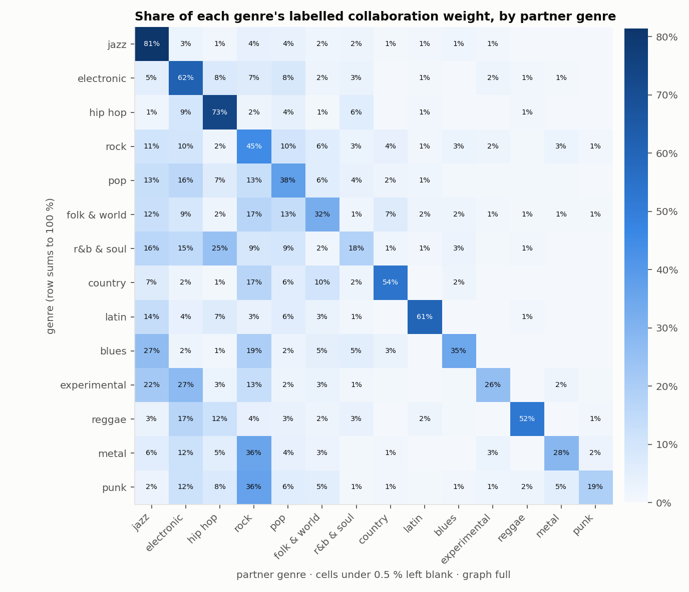

**The bridges** (Table 5) are producers and session players (Adrian Quesada, Gabe Noel, Keefus Ciancia), roots and world-music artists (Jolie Holland, Ry Cooder, Amadou & Mariam, Baaba Maal, Youssou N'Dour) and collective projects (Playing for Change). The top bridge, Putumayo, is a world-music record label credited as an artist on its compilations. It is a data artefact: labels are not on the list of special-purpose artists. We keep it in the ranking and in the ego figures (Figure 6) to show the effect. The other two ego networks show what a real bridge looks like: many collaborators, spread over many genres.

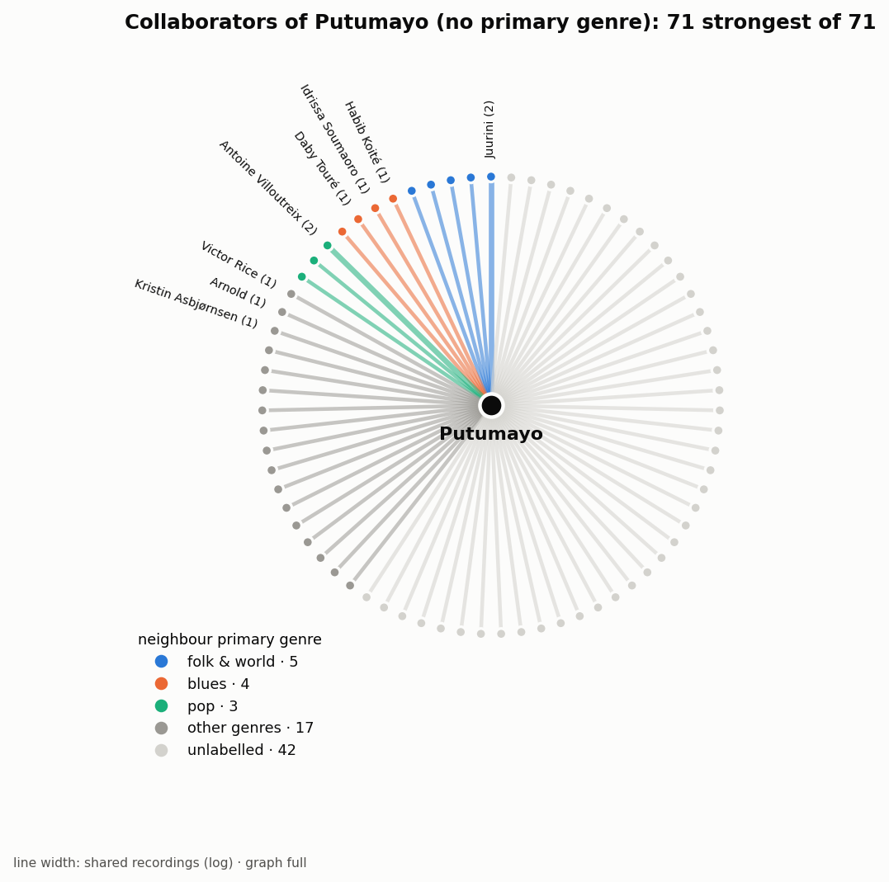
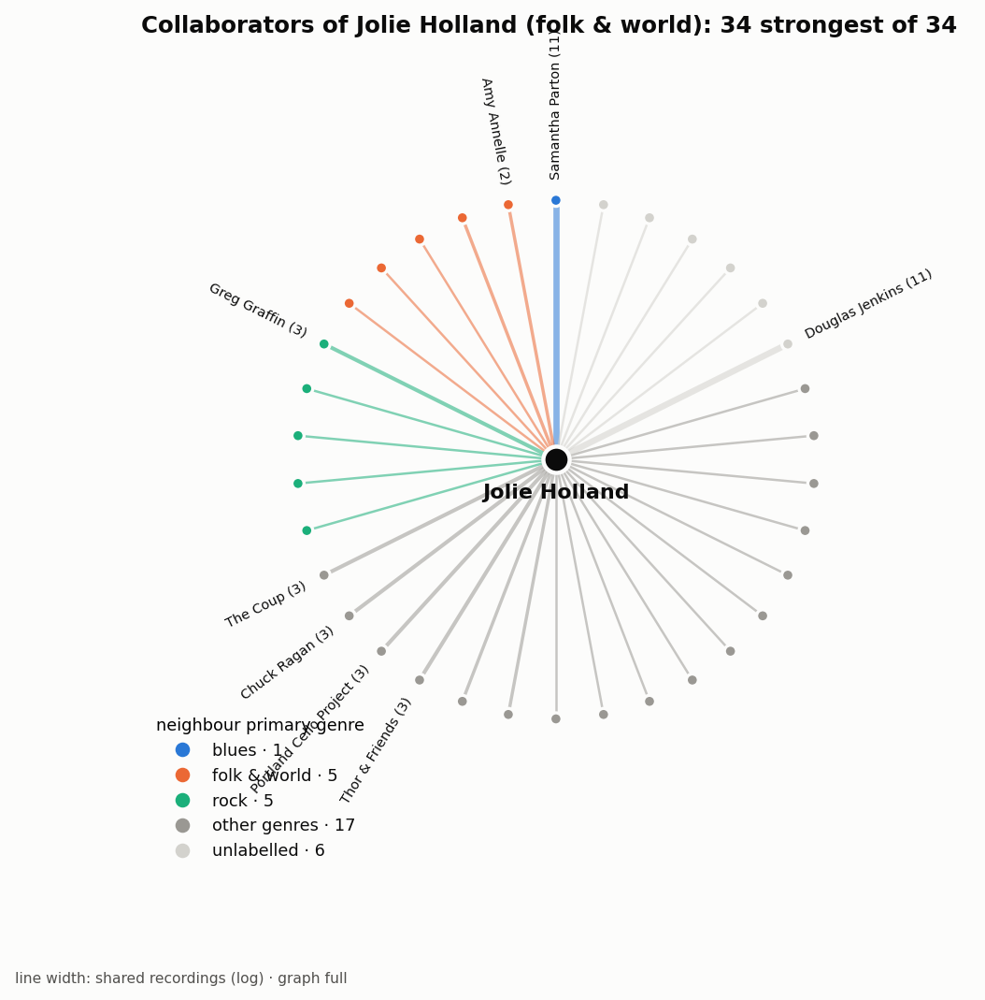
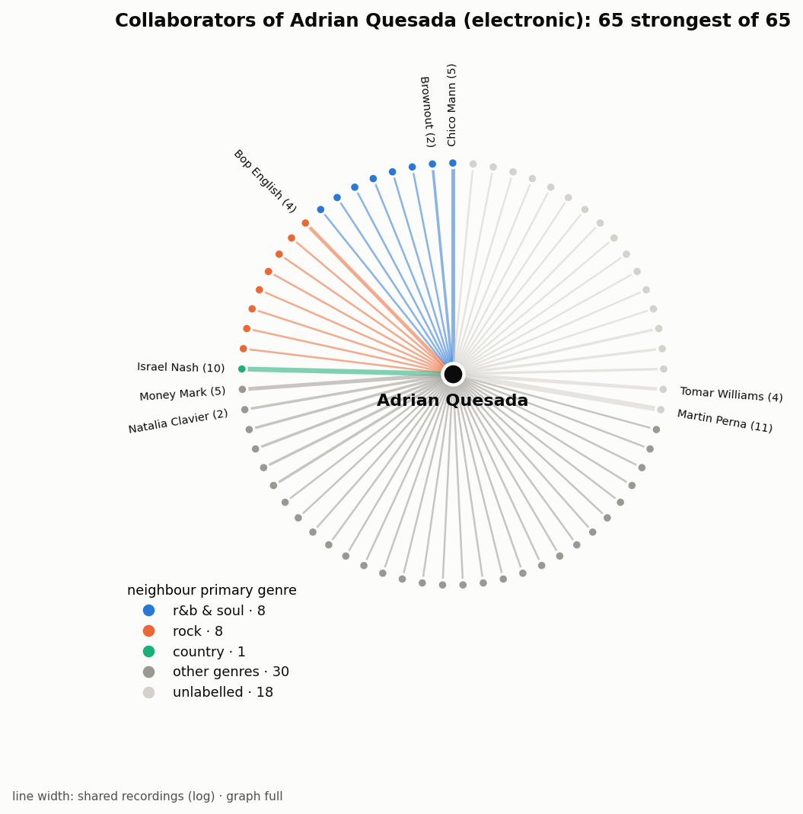

Table 5 — [`rq1_bridges_top`](../reports/tables/report/rq1_bridges_top.md): the top 25 bridges. Table 6 — [`rq1_bridges_summary`](../reports/tables/report/rq1_bridges_summary.md).

**Validation.** 14 of the 15 pre-registered artists are in the graph; Yo‐Yo Ma is classical and therefore excluded (Table 7, Figure 7).
- **Betweenness:** they rank very high, 13 of the 14 in the top 1,000 (median rank 103; `validation_summary.csv`).
- **Bridge score:** three are in the top 100 (Ry Cooder #10, Santana #66, Mark Ronson #80).
- **Under-rated artists:** Quincy Jones and Herbie Hancock rank 43 and 17 by betweenness but around 60,000 of 126,293 by bridge score. Weight-based diversity under-rates artists who collaborate across genres but do most of their work in a large home genre (jazz). This is a known weakness of the measure, not a data error.

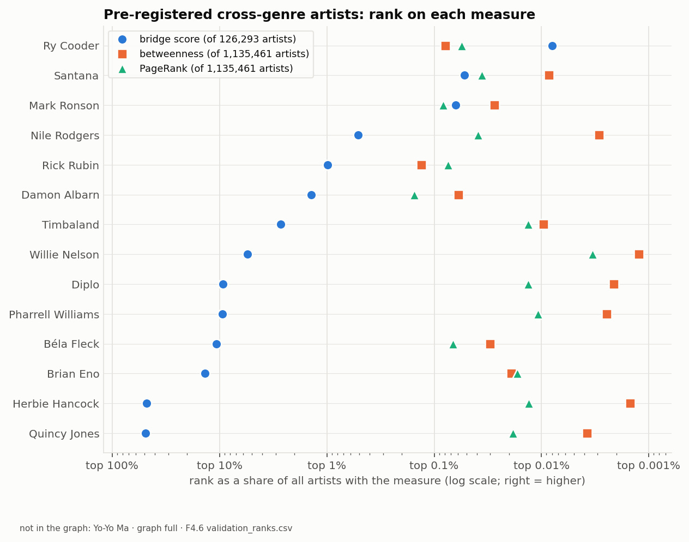

Table 7 — [`rq1_validation`](../reports/tables/report/rq1_validation.md).

**Sensitivity.** Including Character artists changes the bridge top 25 little: 23 of 25 artists in common, Jaccard 0.85. Including classical artists changes it more: 19 of 25, Jaccard 0.61. In neither variant does an artist of the added kind enter the bridge list (`sensitivity_top_lists`).

**Answer to RQ1.** Genre bridges exist but are rare. Three quarters of collaboration stays within genres. The artists who connect genres are mostly producers, session musicians and world and roots musicians, people whose work is to collaborate. The bridge score finds them, and it confirms well-known bridges such as Ry Cooder, Santana and Mark Ronson. It under-rates bridges with a large home genre.

### 6.2 RQ2 — Do collaboration communities match genres?

Louvain finds 72,258 communities with modularity 0.868 (Table 8). The size distribution is extremely skewed (Figure 8):
- one community of 119,494 artists;
- 20 communities of 10,000–99,999 artists, which together hold 47 % of all artists;
- 70,968 communities of fewer than 10 artists.

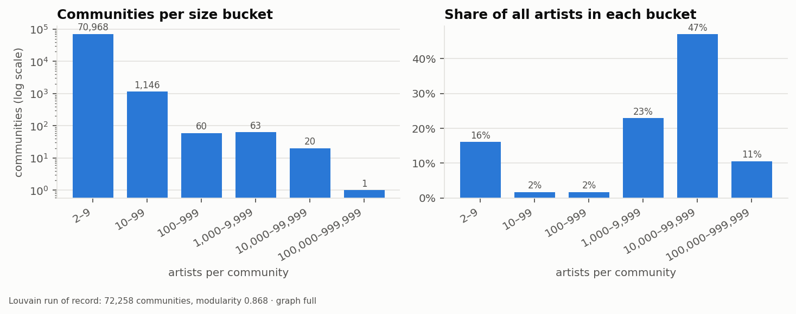

**Agreement with genre is weak.** NMI between community and primary genre is 0.241 and AMI 0.186. Inside the largest connected component (945,860 artists), AMI is 0.224 (`rq2_communities_runs`).

The ten largest communities (Figure 9, Table 9) fall into two kinds:
- **near-pure genre communities:** EDM (#2, 83 % electronic) and swing and big-band jazz (#4, 77 % jazz);
- **scenes that span genres:** US hip hop with electronic producers (#1); Japanese pop, anime and voice actors (#6); reggae and dub with UK grime (#7); reggaeton with Latin rock (#8); European and improvised jazz with electronic music (#9); German hip hop (#10).

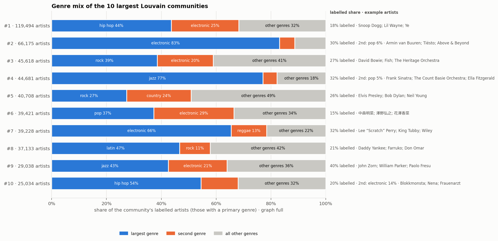

Table 8 — [`rq2_communities_runs`](../reports/tables/report/rq2_communities_runs.md). Table 9 — [`rq2_communities_top`](../reports/tables/report/rq2_communities_top.md).

**Validation.** The result is stable: run-to-run NMI between the four Louvain runs is 0.885–0.897 overall and 0.805–0.825 inside the largest component, and modularity varies by under 0.003. AMI corrects for the many small communities that inflate NMI.

**Answer to RQ2.** Only partly. Collaboration communities are real (high modularity) and stable, but they are scenes defined by geography, era and industry as much as by genre. A few are almost a single genre, and most mix two or three.

### 6.3 RQ3 — Has cross-genre collaboration changed over time?

The cross-genre share of labelled collaboration weight changed over the decades (Figure 10, Table 10):
- it rose from 16.0 % in the 1960s to 23.8–25.4 % in the 1970s and 1980s;
- it dipped to 21.1 % in the 1990s;
- it rose again to 28.4 % in the 2020s.

The featuring share was 2.9–3.7 % before the 1990s, rose to 23.1 % in the 2010s, and stood at 19.0 % in the 2020s. The edge-type mix shifted too (Figure 11): billed credits (CO_CREDITED and FEATURED) replaced performer credits as the main form of documented collaboration.

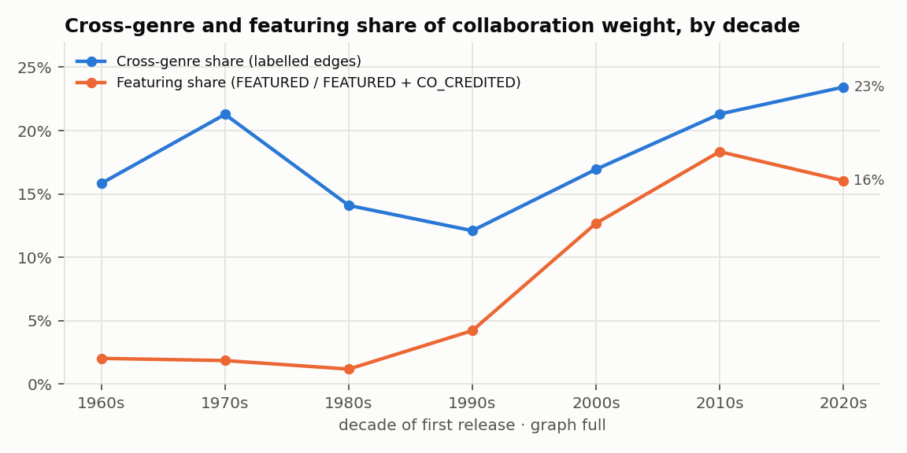

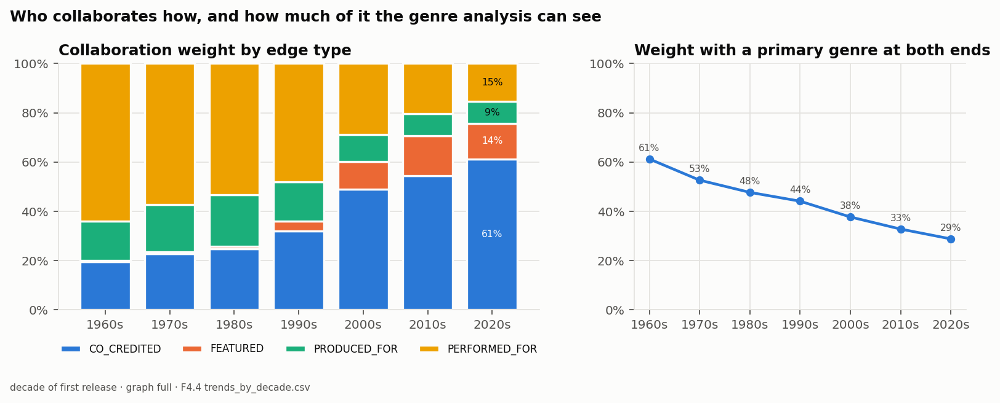

Table 10 — [`rq3_trends`](../reports/tables/report/rq3_trends.md).

**Validation note.**
- **Shrinking coverage:** the labelled share of each decade's weight falls from 61.2 % (1960s) to 28.8 % (2020s). The recent cross-genre share therefore describes a smaller, more popular subset of artists.
- **Fixed genres:** an artist's primary genre is fixed for its whole career, so a change of style counts as cross-genre collaboration.
- **Scope matters:** with classical music included, the curve was U-shaped instead (P4 §4). The trend's shape depends on the scope choice.

**Answer to RQ3.** Yes. Cross-genre collaboration is higher today than in the 1960s and has been rising since the 1990s. The rise of the featuring credit from the 1990s is the clearest change in how collaboration is billed. Both results hold for the labelled, mostly popular part of the data.

### 6.4 RQ4 — Who is most central, and do the measures agree?

**The measures agree overall but not at the top** (Figure 12, Table 11):
- **Overall:** Spearman ρ between the three measures is 0.546–0.671 on COLLAB.
- **At the top:** the top-100 sets barely overlap. Weighted degree and betweenness share a Jaccard of only 0.047, and on the credit-only projection the overlaps fall as low as 0.015.

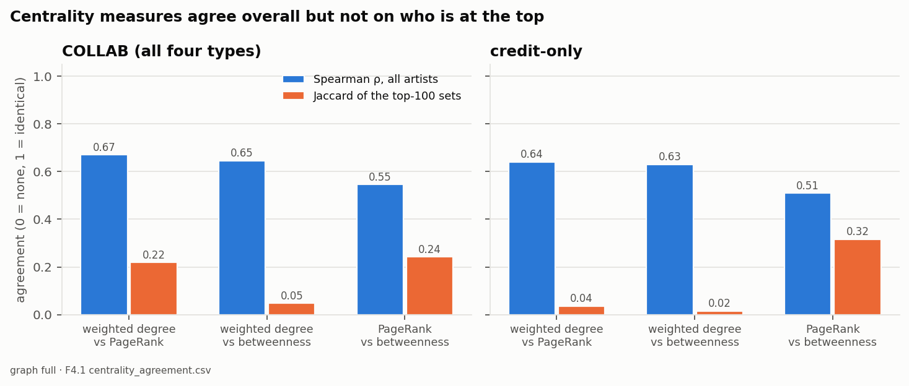

**What each measure surfaces** (Tables 12–13):
- **Weighted degree** rewards volume, and its top 10 is dominated by content artefacts: Bruce Springsteen's live archive with members of the E Street Band, and audiobook authors and narrators (Stephen King, David Nathan, J. K. Rowling, Terry Pratchett). Spoken-word recordings are still in the graph (D-040; §9).
- **PageRank** mixes prolific hubs (Springsteen, Frank Sinatra) with hip hop and EDM artists.
- **Betweenness** surfaces the connectors between scenes: Snoop Dogg, Ye, Busta Rhymes, Pitbull, Sting, Elton John, Akon, David Guetta. A worship-music label, Vineyard Music, is a data artefact like Putumayo.

**Credit-only vs COLLAB.** Each measure correlates strongly between the two projections (ρ 0.887–0.941; `rq4_agreement`), yet their top-100 sets overlap by only 0.41–0.49. Producer and performer credits shift who is at the very top.

Table 11 — [`rq4_agreement`](../reports/tables/report/rq4_agreement.md). Table 12 — [`rq4_centrality_top_collab_undirected`](../reports/tables/report/rq4_centrality_top_collab_undirected.md). Table 13 — [`rq4_centrality_top_credit_only`](../reports/tables/report/rq4_centrality_top_credit_only.md).

**Validation note.**
- **Spot checks:** every top 10 was spot-checked for artefacts (F4.6).
- **Betweenness reproducibility:** sampled betweenness is reproducible within one import of the graph but not across re-imports (§9). We therefore quote betweenness ranks and percentiles, not the exact order of its top 20.

**Answer to RQ4.** It depends on the measure, and they disagree most where it matters, at the top. Volume-based centrality finds archives and audiobooks. Betweenness finds the artists who connect scenes, mostly in hip hop and pop, and these overlap with the bridges of RQ1.

### 6.5 Degrees of separation

The collaboration world is small (Table 14, `separation_paths`):
- **Frank Sinatra → Snoop Dogg:** 2 hops via Stevie Wonder, with 6 shortest paths.
- **Johnny Cash → Armin van Buuren:** 3 hops, via Stevie Wonder and Jon Bon Jovi.
- **Manfred Eicher (the ECM jazz producer) → Gucci Mane:** 3 hops, via Michael Brecker and Aretha Franklin.

Each hop is a documented collaboration: a shared billing, a featuring or a producer or performer credit.

Table 14 — [`separation_paths`](../reports/tables/report/separation_paths.md).

### 6.6 Sensitivity to the scope choices

The two variant graphs test the two biggest scope decisions (Tables 15–16):
- **Character artists:** including them barely changes the overall agreement between measures (every ρ within 0.004; `sensitivity_agreement`). But the Vocaloid 初音ミク (Hatsune Miku) becomes #1 by PageRank on both projections, and up to six voicebanks enter the credit-only PageRank top 20 (`sensitivity_top_lists`). This confirms their exclusion (D-021): a voicebank is an instrument, not a collaborator.
- **Classical artists:** including them replaces large parts of every centrality top 20 with orchestras and conductors (top-20 Jaccard 0.25–0.48) and changes the bridge list more. No classical artist becomes a top bridge.

The conclusions of RQ1, RQ2 and RQ4 hold in both variants; RQ3's trend shape depends on the classical decision (§6.3).

Table 15 — [`sensitivity_top_lists`](../reports/tables/report/sensitivity_top_lists.md). Table 16 — [`sensitivity_agreement`](../reports/tables/report/sensitivity_agreement.md).

## 7. Benchmarks

**Spark scaling (FR-21).** The benchmarked workload is the recording chain:
- credit parsing;
- contribution extraction;
- first release years;
- graph build.

It ran on 10/25/50/100 % of the data and 1/2/4/8 cores, three times each, each run in a fresh process (D-041). The full chain takes 1,224 s on one core and 385 s on eight, a speedup of 3.18 with efficiency 0.40 (Figure 13, Table 17). Speedup flattens after four cores; the eight cores mix the laptop CPU's performance and efficiency cores. Smaller fractions scale slightly worse. Every sample still scans the full raw tables, so about a quarter of the runtime is fixed cost.

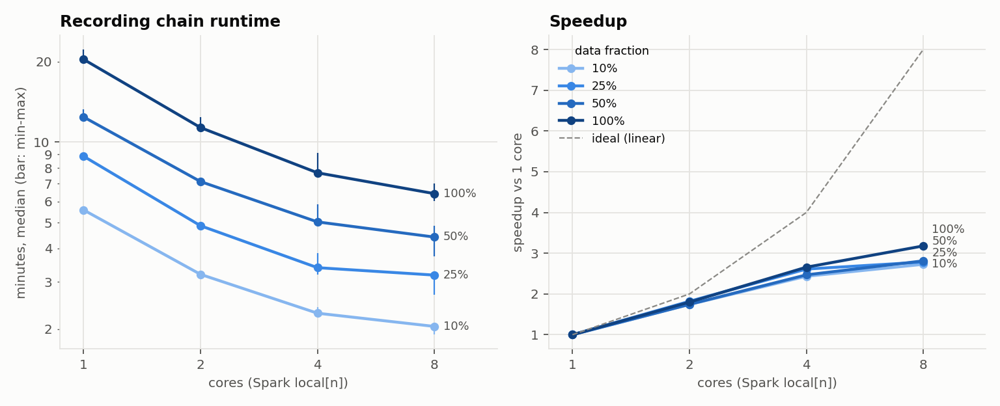

**PageRank engines (FR-22, FR-23).** We ran unweighted PageRank on the identical 2,863,538 COLLAB pairs in three engines, with the same damping, tolerance and cores (D-042, D-043): Neo4j GDS, Spark GraphFrames and RAPIDS cuGraph on the laptop GPU. All three give the same top 100 (Jaccard 1.00) and Spearman ρ of at least 0.99993 against GDS (Table 18, Figure 14). Compute time differs widely:
- GDS: 3.8 s;
- GraphFrames: 470 s, about 123 times GDS's;
- cuGraph: 0.20 s, about a twentieth of GDS's.

End to end, the times are 30.3 s, 482 s and 1.1 s.

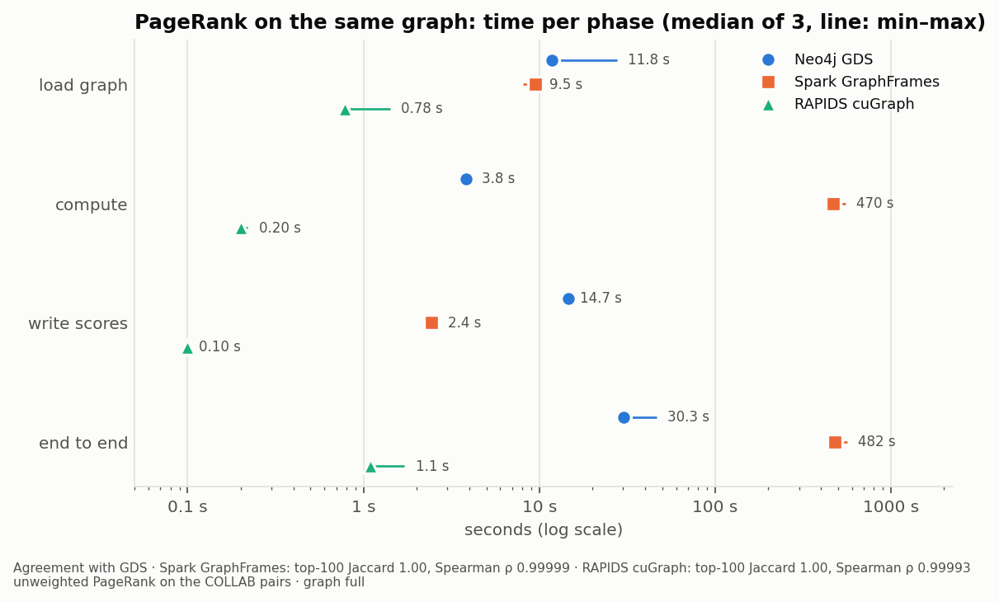

Table 17 — [`bench_scaling`](../reports/tables/report/bench_scaling.md). Table 18 — [`bench_pagerank`](../reports/tables/report/bench_pagerank.md). Table 19 — [`bench_environment`](../reports/tables/report/bench_environment.md): the benchmark environment.

**What this means for the architecture.**
- **Spark** processes the full relational dump on one laptop in minutes and is the right tool for the ETL.
- **For the graph algorithms,** a dedicated graph engine wins by two orders of magnitude over Spark's graph library, with identical results.
- **The GPU is faster still,** but at a million nodes GDS is already fast. Neo4j is needed anyway for Cypher paths, stored results and the live demo. The GPU would matter for larger graphs or many repeated runs.

## 8. Discussion

Together, the four answers describe a collaboration world that is mostly organised by genre and scene:
- three quarters of collaboration stays within one genre;
- communities are scenes held together by place, era and industry;
- the most central connectors are a small group of prolific pop and hip hop artists.

Cross-genre collaboration nonetheless grew over the decades, and the featuring credit became a standard way to bill it. The artists who bridge genres are less often stars than professionals whose work is to collaborate, such as producers, session players and world-music artists.

The project also shows how much the answers depend on data decisions:
- excluding classical music changed the RQ3 trend shape and every centrality top list;
- including Character artists would have put a Vocaloid at the top of PageRank;
- labels credited as artists and spoken-word recordings still shape the top lists.

Documenting each filter, counting what it removes and re-running the analysis on variant graphs made these effects visible instead of hidden.

With more time we would address the open items in §9:
- a recording-level spoken-word filter;
- reproducible betweenness across imports;
- a log transform of weights.

We would also try per-period genre attribution and release-level credits (OD7).

## 9. Limitations

**Data and coverage**
- **Volunteer data.** Results reflect what MusicBrainz editors chose to document. Contribution credits are rich for popular music and sparse elsewhere: 4.4 % of recordings have a producer credit (`profile_summary.csv`). Rankings favour well-documented artists.
- **Genre coverage is a minority.** 22.0 % of the graph's artists have a primary genre, and the labelled share of each decade's weight falls from 61.2 % to 28.8 % (`rq3_trends`). This is the main caveat for RQ1–RQ3.
- **One genre per artist, for all time.** Attribution uses the primary genre only, not the genre profile, and does not change over an artist's career.
- **Classical music is excluded** from the main graph (D-039) and analysed only as a variant. One pre-registered artist, Yo‐Yo Ma, is therefore missing from the validation.

**Open scope items** (parked by the team; `docs/g1-open-items.md`)
- **Spoken word is still in the graph** (D-040). Audiobook authors and narrators rank high on weighted degree in both projections. A recording-level filter was proposed but not built.
- **Sampled betweenness is not reproducible across re-imports** of the same graph. On an identical rebuild, the betweenness top 20 shared only 16 of 20 artists with the earlier run (P4 §7). The likely cause, unsorted export rows changing internal node ids and with them the sampled sources, is not verified. Within one import the results are reproducible (D-033), and we quote betweenness by rank and percentile only.
- **Weights are not log-transformed** for the weighted measures, so weight outliers such as a live archive stay at the top of weighted degree.
- **Two graph-build rules await formal sign-off by both members** (D-027 `recording_count`; D-028 one count per recording and pair). They are implemented as described.

**Method**
- **Record labels credited as artists** (Putumayo, Vineyard Music) are not filtered and appear in the top lists.
- **Weight-based diversity under-rates bridges with a large home genre** (Quincy Jones, Herbie Hancock; §6.1). For every artist with a defined score, the bridge score is close to the diversity score, because all of them have high betweenness percentiles (D-038).
- **The pre-registered list was chosen by Claude Code at member B's request** (D-037), not independently by both members as planned. It was still committed before any RQ1 result. The spot-check verdicts need both members' review.

**Benchmarks**
- **One machine.** The numbers describe one laptop: GDS Community limited to 4 cores, Spark in local mode, a laptop GPU. They justify this project's architecture, not general claims about the engines. Run-to-run spread is reported as min–max.

## 10. Reproducibility

**One command per stage.** Every stage runs with one documented command from `config/pipeline.yaml`. The container images, library versions and the data snapshot are pinned.
- **Fresh clone:** a fresh clone was checked end to end in sample mode, and the README was corrected where a new user would have been stuck (F6.5).
- **Full mode:** it runs on the reference machine. F5.1 times the full recording chain at 385 s on 8 cores (`bench_scaling`), and each feature doc records its stage's runtime.

**Generated outputs.** Every figure and table in this report is generated by code from the pipeline's outputs (FR-24). `reports/README.md` lists each with the command that makes it, and every result row names the graph and edges fingerprint it came from.

**Build log.** The build log in `docs/` records every feature, every phase and every decision (D-001 to D-044).

**AI assistance** (draft statement; the team to confirm against the course policy). Most of the pipeline code, the build-log documents and this draft were written with Claude Code (Anthropic) under the team's direction and review. Every number comes from the generated files.

## 11. Conclusion

We built a complete big-data pipeline from the raw MusicBrainz export to a validated collaboration graph of 1.1 million artists and answered four questions about genres:
- **Bridges (RQ1):** genre bridges are rare, and they are mostly producers, session musicians and world musicians.
- **Communities (RQ2):** communities are scenes rather than genres.
- **Trends (RQ3):** cross-genre collaboration has grown since the 1960s, with featuring credits rising sharply from the 1990s.
- **Centrality (RQ4):** centrality measures disagree at the top, and betweenness best captures the connectors.

The benchmarks support the design: Spark for the ETL, a graph engine for the algorithms.

## References

- Blondel, V. D., Guillaume, J.-L., Lambiotte, R., & Lefebvre, E. (2008). Fast unfolding of communities in large networks. *Journal of Statistical Mechanics: Theory and Experiment*, P10008.
- Brandes, U. (2001). A faster algorithm for betweenness centrality. *Journal of Mathematical Sociology*, 25(2), 163–177.
- Bryan, N. J., & Wang, G. (2011). Musical influence network analysis and rank of sample-based music. *Proceedings of the 12th International Society for Music Information Retrieval Conference (ISMIR)*, 329–334.
- Freeman, L. C. (1977). A set of measures of centrality based on betweenness. *Sociometry*, 40(1), 35–41.
- Gleiser, P. M., & Danon, L. (2003). Community structure in jazz. *Advances in Complex Systems*, 6(4), 565–573.
- MusicBrainz / MetaBrainz Foundation. MusicBrainz database, full export `20261007-002147`. Core data CC0; derived data (tags) CC BY-NC-SA 3.0. https://musicbrainz.org/
- Newman, M. E. J. (2001). The structure of scientific collaboration networks. *Proceedings of the National Academy of Sciences*, 98(2), 404–409.
- Page, L., Brin, S., Motwani, R., & Winograd, T. (1999). The PageRank citation ranking: Bringing order to the web. Technical report, Stanford InfoLab.
- Park, J., Celma, Ò., Koppenberger, M., Cano, P., & Buldú, J. M. (2007). The social network of contemporary popular musicians. *International Journal of Bifurcation and Chaos*, 17(7), 2281–2288.
- Simpson, E. H. (1949). Measurement of diversity. *Nature*, 163, 688.
- Swartz, A. (2002). MusicBrainz: A semantic web service. *IEEE Intelligent Systems*, 17(1), 76–77.
- Vinh, N. X., Epps, J., & Bailey, J. (2010). Information theoretic measures for clusterings comparison. *Journal of Machine Learning Research*, 11, 2837–2854.
- Software: Apache Spark 3.5.9, Neo4j 5.26 Community with Graph Data Science 2.13, GraphFrames 0.12.3, RAPIDS cuGraph 26.08, scikit-learn, matplotlib.

## Appendix A — Key decisions

The full log is `docs/decisions.md`. The decisions an examiner most needs:

| Decision | What it settles |
|---|---|
| D-004 | No Hadoop, HDFS or Hive |
| D-017 | COLLAB projection: one undirected relationship per pair, weights summed |
| D-021 | Character artists excluded (sensitivity variant kept) |
| D-026–D-028 | Graph-build rules: credit-size filter, drop order, one count per recording and pair |
| D-033, D-034 | Algorithm settings for reproducibility (betweenness and Louvain single-threaded, PageRank to convergence) |
| D-037 | Validation list, committed before any RQ1 result |
| D-039, D-040 | Scope gate: classical analysed separately; other provisional values confirmed |
| D-041–D-043 | Benchmark designs |
| D-044 | Report figures and tables generated from the result tables |

## Appendix B — Build log

`docs/README.md` indexes one document per feature and per phase. Each gives the commands, real row counts and runtimes, and known issues.
